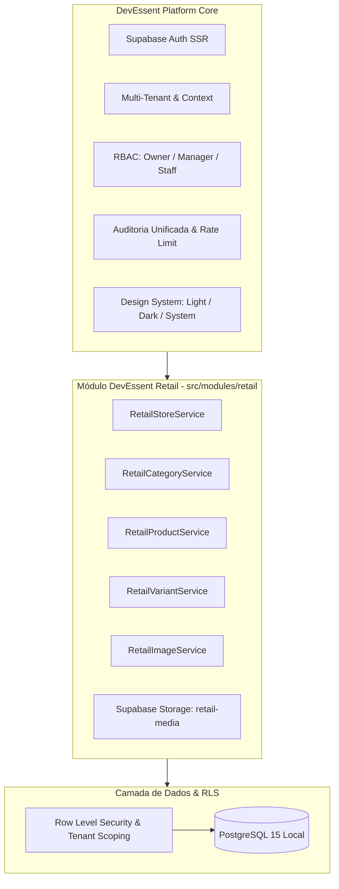
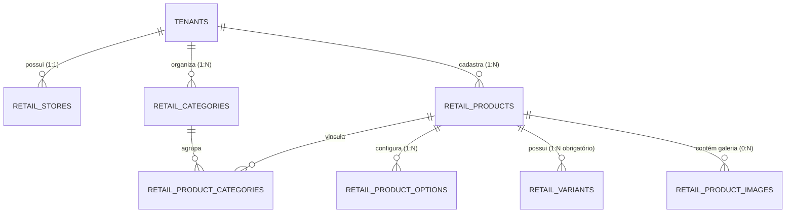

# DEVESSENT PLATFORM — RELATÓRIO DE HOMOLOGAÇÃO DA FASE 6A
## Módulo Comercial Reutilizável: DevEssent Retail (Catálogo, Produtos, Variantes, Imagens e Administração)

> [!IMPORTANT]
> **Status da Fase 6A: CONCLUÍDA E HOMOLOGADA COM SUCESSO**  
> Todos os 9 portões obrigatórios de conformidade e qualidade foram executados localmente e aprovados sem falhas:  
> - **154 testes Vitest** aprovados (20 arquivos de teste unitário e integração real).  
> - **71 testes pgTAP** aprovados no PostgreSQL local via Docker (4 arquivos SQL de banco).  
> - **30 testes Playwright E2E** aprovados no navegador Chromium (6 suítes completas).  
> - **9/9 cenários Sandbox** verificados com 100% de aprovação (Cenários A a I).  
> - **TypeScript `tsc --noEmit`**, **ESLint** e **Next.js Production Build (`next build`)** aprovados com zero erros.

---

## 1. Visão Geral e Escopo da Fase 6A

A software house DevEssent concebeu a plataforma como um núcleo SaaS multiempresa reutilizável. A Fase 6A inaugura o primeiro vertical comercial conectado sobre este core: o **DevEssent Retail**, projetado para suportar operações comerciais como lojas de moda autoral, coleções cápsula, vestuário urbano, botânica e decoração de interiores.



### Princípios Arquiteturais Cumpridos:
1. **Monolito Modular:** Implementado estritamente em `src/modules/retail/`, respeitando a fronteira do Core.
2. **Inversão de Dependência:** O Core (`src/core/`) **nunca** importa arquivos de `src/modules/` (garantido por `pnpm check:project`).
3. **Isolamento de Sandbox:** Nenhuma importação de `sandbox-data/` dentro de `src/`.
4. **Isolamento Multiempresa:** RLS ativo e forçado em todas as 7 tabelas e no bucket de mídia `retail-media`.

---

## 2. Modelagem do Banco de Dados e Migração 008

A migração `supabase/migrations/20260301000008_retail_module_catalog.sql` foi aplicada com sucesso sobre a stack local do Supabase (`127.0.0.1:54322`).



### Tabelas Criadas:
1. `retail_stores`: configurações comerciais da unidade (moeda BRL, status ativo, controle de estoque).
2. `retail_categories`: categorias hierárquicas e ordenáveis (`sort_order`), com unicidade de slug por tenant (`UNIQUE(tenant_id, slug)`).
3. `retail_products`: cadastro central de produtos com slug único por tenant, estados (`draft`, `published`, `archived`) e carimbo de publicação.
4. `retail_product_categories`: tabela de junção N:N entre produtos e categorias.
5. `retail_product_options`: opções e atributos estruturados (ex.: Tamanho, Cor, Material).
6. `retail_variants`: variantes físicas com SKU único por tenant (`UNIQUE(tenant_id, sku)`), preço de venda em centavos (`price_cents > 0`), preço de comparação (`compare_at_price_cents >= price_cents`) e estoque.
7. `retail_product_images`: galeria de fotos integrada ao Supabase Storage bucket `retail-media`.

### Políticas RLS e Armazenamento:
- `owner` e `manager`: permissão total de leitura e escrita nos dados da sua empresa ativa.
- `staff`: leitura restrita aos dados da empresa vinculada; qualquer mutação é rejeitada na base.
- `anon` / público: leitura autorizada apenas para lojas ativas e produtos `published` com variantes disponíveis.
- Supabase Storage: bucket `retail-media` provisionado como público para download rápido de assets, com RLS no upload/delete restringindo mutações a membros gestores do tenant especificado na pasta `retail/{tenant_id}/*`.

---

## 3. Invariantes de Negócio e Validações de Domínio

O módulo encapsula as regras comerciais em classes puras de domínio (`ProductInvariants` e `VariantInvariants`) e schemas Zod:

1. **Auto-slugificação Segura:** Normalização de strings Unicode com remoção de diacríticos e caracteres não alfanuméricos.
2. **Unicidade de SKU e Preços Inteiros:** O SKU é sanitizado para caixa alta sem espaços. Preços são armazenados em centavos inteiros (`price_cents`) para evitar erros de ponto flutuante monetário.
3. **Condições Rígidas de Publicação (`checkPublicationReadiness`):**
   - Nome obrigatório com mínimo de 2 caracteres.
   - Pelo menos uma variante cadastrada.
   - Toda variante ativa deve ter preço superior a zero centavos.
   - O preço promocional ou original de comparação não pode ser inferior ao preço de venda efetivo.
4. **Reserva e Reposição de Estoque:** Validações de decremento para impedir que o estoque físico fique negativo.

---

## 4. Auditoria Unificada e Integração RBAC

Todas as operações comerciais do Retail foram plugadas no subsistema unificado de auditoria do Core (`AuditService`), catalogadas sob a categoria `"comercial"`:

| Ação de Auditoria | Descrição Operacional | Nível de Acesso Mínimo |
| :--- | :--- | :--- |
| `retail.category_created` | Criação de nova categoria de produtos | Manager / Owner |
| `retail.category_updated` | Atualização cadastral de categoria | Manager / Owner |
| `retail.category_deleted` | Exclusão de categoria vazia | Manager / Owner |
| `retail.product_created` | Cadastro inicial de produto e variantes | Manager / Owner |
| `retail.product_updated` | Alteração de dados ou opções de produto | Manager / Owner |
| `retail.product_published` | Publicação comercial do produto | Manager / Owner |
| `retail.product_archived` | Retirada de produto da vitrine | Manager / Owner |
| `retail.product_deleted` | Exclusão de produto e descarte de mídias | Manager / Owner |
| `retail.price_updated` | Reajuste pontual de preço de variante | Manager / Owner |
| `retail.stock_adjusted` | Ajuste de inventário físico ou inventariação | Manager / Owner |
| `retail.image_uploaded` | Upload e vinculação de mídia no Storage | Manager / Owner |
| `retail.store_updated` | Alteração de parâmetros da loja | Owner |

---

## 5. Demonstração Visual das Telas da Fase 6A

As capturas a seguir foram geradas a partir da aplicação em execução no ambiente local (`http://localhost:3000`), documentando o suporte aos temas Claro e Escuro.

````carousel

<!-- slide -->

<!-- slide -->

<!-- slide -->

<!-- slide -->

<!-- slide -->

<!-- slide -->

<!-- slide -->

<!-- slide -->

<!-- slide -->

<!-- slide -->

<!-- slide -->

<!-- slide -->

<!-- slide -->

````

---

## 6. Bateria de Testes e Portões de Qualidade

Os testes foram executados contra instâncias reais (PostgreSQL Docker e Supabase local).

```
========================================================================================
                                QUADRO GERAL DE TESTES
========================================================================================
 Suíte de Testes              | Arquivos | Testes | Status | Observações
----------------------------------------------------------------------------------------
 Vitest (Unitários & Int.)    | 20       | 154    | PASS   | 19 testes dedicados ao Retail
 pgTAP (PostgreSQL DB RLS)    | 4        | 71     | PASS   | 21 testes dedicados ao Retail
 Playwright (E2E Browser)     | 6        | 30     | PASS   | 5 testes dedicados ao Retail
 Sandbox Verification         | 1        | 9      | PASS   | Cenários A até I (100% sucesso)
 TypeScript (`tsc --noEmit`)  | -        | -      | PASS   | Zero erros de tipagem
 ESLint Linter                | -        | -      | PASS   | Zero warnings / zero erros
 Next.js Production Build     | -        | 24 rotas| PASS   | Todas as páginas estáticas e dinâmicas
========================================================================================
 TOTAL GERAL DE TESTES AUTOMATIZADOS: 255 TESTES APROVADOS COM 100% DE SUCESSO
========================================================================================
```

---

## 7. Diretrizes Modern Web Guidance Aplicadas

Em consonância com as melhores práticas de desenvolvimento web moderno:
- **Diálogo Nativo HTML5:** Utilização de `<dialog>` para criação/edição de categorias com manipulação via `dialogRef.current?.showModal()` e suporte a `backdrop:bg-black/60`.
- **Acessibilidade Semântica (a11y):** Vinculação explícita de `label[htmlFor]` com `input[id]`, atributos `role="alert"` e `role="status"` para feedbacks assíncronos.
- **Tipografia e Tokens CSS:** Integração contínua com os tokens de design do DevEssent Core (`var(--accent)`, `var(--surface)`, `var(--border)`, `var(--t-fill)`).
- **Sem Flash de Tema Não Estilizado (FOUC):** Persistência do atributo `data-theme` na tag `<html>`.

---

## 8. Próximos Passos (Fase 6B)

Com o motor de catálogo, produtos, variantes, imagens e administração multiempresa homologado, o projeto está pronto para a **Fase 6B: Vitrine Comercial Pública, Carrinho e Checkout**:
1. Criação do layout público da loja virtual (rotas públicas com resolução por slug/subdomínio do tenant).
2. Vitrine dinâmica de produtos e visualização detalhada de peças com seleção de variantes (tamanho, cor).
3. Gerenciamento de carrinho de compras com persistência local e validação de estoque em tempo real.
4. Estrutura de checkout e ordens de pedido (`retail_orders` e `retail_order_items`).
