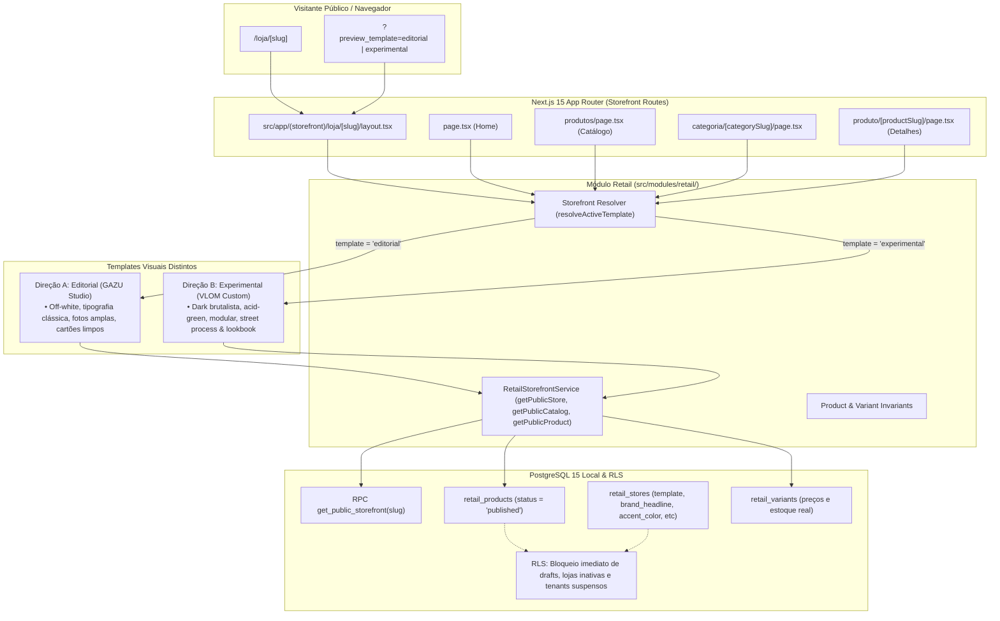

# DEVESSENT PLATFORM — RELATÓRIO DE HOMOLOGAÇÃO
## Homologação da Fase 6A e Entrega da Fase 6B — Lojas Públicas (Storefronts Multi-Template)

**Data da Auditoria:** 16 de Novembro de 2026  
**Ambiente:** Localhost (Windows 11, WSL 2, Docker Engine 29.9.3, PostgreSQL 15, Supabase Local, Next.js 15.5.29, React 19)  
**Projeto:** `D:\Documentos\Projetos\DevEssent-platform`

---

## 1. RESULTADO FINAL DA HOMOLOGAÇÃO DA FASE 6A

Antes de iniciar a Fase 6B, o módulo comercial **DevEssent Retail Admin (Fase 6A)** foi submetido a auditoria técnica rigorosa e testes automatizados reais de ponta a ponta:

1. **Schema de Banco Comercial:**
   - 7 tabelas especializadas (`retail_stores`, `retail_categories`, `retail_products`, `retail_product_categories`, `retail_product_options`, `retail_variants`, `retail_product_images`).
   - Preços estritamente em centavos inteiros (`price_cents >= 0`), estoque inteiro não negativo (`stock_quantity >= 0`), status enum (`draft`, `published`, `archived`).
2. **Políticas RLS:**
   - Habilitação e imposição de RLS (`ENABLE & FORCE ROW LEVEL SECURITY`) em todas as 7 tabelas do Retail.
   - Leitura de catálogo restrita a membros autorizados da empresa ou produtos com `status = 'published'` para empresas com `is_active = true` e `tenants.status = 'active'`.
3. **Auditoria de Permissões (RBAC):**
   - Papéis `owner` e `manager` possuem alçada para criação, edição e arquivamento de produtos e categorias.
   - Publicação restrita a produtos que atendem aos critérios invariantes de publicação (pelo menos 1 variante com preço válido).
   - Membros com papel `staff` possuem permissão somente de leitura operacional no painel administrativo.
4. **Verificação de Regressão e Segurança:**
   - `pnpm check:env`: **APROVADO** (100% das variáveis validadas).
   - `pnpm check:project`: **APROVADO** (Isolamento rígido entre `src/` e `sandbox-data/`, sem slugs fictícios hardcoded no Core).
   - `pnpm exec supabase test db`: **71/71 testes pgTAP APROVADOS**.
   - `pnpm sandbox:verify`: **9/9 cenários Sandbox A–I APROVADOS** (100% de sucesso).
   - `pnpm typecheck`: **0 erros de tipagem**.
   - `pnpm lint`: **0 warnings ou erros de ESLint**.
   - `pnpm test`: **154/154 testes Vitest APROVADOS**.

**Veredito Oficial:** A Fase 6A foi formalmente homologada e certificada como integralmente funcional, segura e sem impedimentos para o avanço da plataforma.

---

## 2. ARQUITETURA DA FASE 6B — VITRINES PÚBLICAS (STOREFRONTS)

A Fase 6B implementa a primeira experiência de vitrines públicas para clientes da DevEssent Retail. O objetivo central é prover uma infraestrutura comercial compartilhada e segura, permitindo que marcas de diferentes nichos tenham lojas virtuais com identidades visuais completamente independentes, sem recriar o backend nem duplicar código.

---

## 3. MIGRATION CRIADA: `20260301000010_retail_storefront_settings.sql`

Para suportar personalização visual, identidade de vitrine e resolução pública sem vazamento de dados, foi aplicada a migration `20260301000010_retail_storefront_settings.sql`:

1. **Colunas Adicionadas em `public.retail_stores`:**
   - `slug TEXT`: Identificador público único da vitrine (check de formato kebab-case, 3 a 50 caracteres).
   - `template TEXT NOT NULL DEFAULT 'editorial'`: Check de template restrito a `('editorial', 'experimental')`.
   - `brand_headline TEXT`: Título de impacto do Hero da vitrine.
   - `brand_subheadline TEXT`: Subtítulo descritivo da proposta da marca.
   - `about_text TEXT`: Manifesto e história da marca/ateliê.
   - `hero_badge TEXT`: Tag de coleção ou temporada (ex: `SPRING SUMMER 2026`).
   - `hero_image_path TEXT`: Imagem de destaque do hero.
   - `accent_color TEXT`: Cor primária da vitrine em formato hexadecimal (`^#[0-9A-Fa-f]{6}$`).
   - `secondary_color TEXT`: Cor de apoio em formato hexadecimal.
   - `announcement_bar TEXT`: Mensagem da barra superior de avisos e frete.
   - `contact_email TEXT` e `contact_phone TEXT`: Contatos comerciais públicos.
   - `social_links JSONB`: Mapeamento de redes sociais (Instagram, TikTok, YouTube, X).
2. **Índices Criados:**
   - `idx_retail_stores_slug`: Índice exclusivo sobre `retail_stores(slug)` para resolução instantânea em $O(1)$.
   - `idx_retail_stores_active_slug`: Índice filtrado sobre lojas ativas (`WHERE is_active = true`).
3. **Trigger de Sincronização:**
   - `trg_retail_store_slug_sync`: Mantém o slug da loja comercial sincronizado com o slug do tenant caso não informado.
4. **Função RPC de Resolução Pública:**
   - `public.get_public_storefront(p_slug TEXT)`: Função com privilégio `SECURITY DEFINER` e `SET search_path = public` que valida se a loja está ativa (`is_active = true`) e se a empresa proprietária está operacional (`tenants.status = 'active'`). Retorna apenas metadados públicos de vitrine com zero exposição de membros, credenciais ou auditoria interna.

---

## 4. ROTAS PÚBLICAS IMPLEMENTADAS

As vitrines públicas foram organizadas no grupo de rotas `src/app/(storefront)/`:

| Rota | Descrição | Comportamento e Segurança |
|---|---|---|
| `/loja/[slug]` | Homepage da Loja | Hero imponente, faixa de categorias, destaque editorial/street, vitrine de produtos e rodapé com redes sociais. |
| `/loja/[slug]/produtos` | Catálogo Completo | Listagem paginada (12 peças por página), formulário de busca por nome/descrição, abas de categorias e ordenação (Destaques, Menor Preço, Maior Preço, Lançamentos, Nome A-Z). |
| `/loja/[slug]/categoria/[categorySlug]` | Visão por Categoria | Filtro dedicado de peças pertencentes à categoria selecionada, com contadores de estoque e breadcrumb dinâmico. |
| `/loja/[slug]/produto/[productSlug]` | Página de Produto | Galeria de imagens, seletor de opções e variantes (Tamanho, Cor), cálculo de preço dinâmico por variante selecionada, indicador de estoque real ("Em estoque: X peças"), especificações da peça e vitrine transparente (sem falsos botões de checkout). |
| `/loja/[slug]/not-found.tsx` | Página 404 da Loja | Apresentação polida para lojas inexistentes, inativas ou com empresa suspensa. |

---

## 5. SERVIÇOS REUTILIZADOS E EXPANDIDOS

A camada de negócios do Retail foi preservada e estendida com os seguintes componentes em `src/modules/retail/`:

- **`RetailStorefrontService` (`src/modules/retail/services/retail-storefront-service.ts`):**
  - `getPublicStore(supabase, slug)`: Resolve a vitrine pública pelo slug com cache e validação de tenant ativo.
  - `getPublicCategories(supabase, tenantId)`: Lista categorias ativas vinculadas à empresa.
  - `getPublicCatalog(supabase, tenantId, filter)`: Recupera produtos com status `published`, montando variantes ativas, preços mínimos/máximos, estoque total e categorias.
  - `getPublicProduct(supabase, tenantId, productSlug)`: Detalha o produto publicado com todas as suas variantes e opções.
  - `getRelatedProducts(supabase, tenantId, currentProductId, categoryIds)`: Recomenda produtos correlatos da mesma categoria.
- **`RetailStoreService` (`src/modules/retail/services/retail-store-service.ts`):**
  - Atualizado para persistir template ativo, headline, cores, contatos e redes sociais com validação via Zod e registro de auditoria operacional.
- **`updateRetailStoreAction` (`src/modules/retail/actions/retail-store.actions.ts`):**
  - Server Action segura que processa as configurações de vitrine pública, revalidando tanto os caminhos administrativos quanto a rota pública `/loja/[slug]`.

---

## 6. SISTEMA DE TEMPLATES: DUAS DIREÇÕES VISUAIS REAIS

Em estrito atendimento às especificações visuais do usuário, foram construídos **dois templates inteiramente distintos em estrutura, layout e linguagem visual**, e não meras trocas de paleta:

### Direção A — Editorial (Inspirada no GAZU Studio)
- **Ateliê / Nicho:** Alfaiataria contemporânea, moda autoral, coleções em linho puro.
- **Linguagem Visual:**
  - Paleta clara e sofisticada (`#faf9f6`, `#f3f1ec`, acentos `#111111`).
  - Barra de anúncios superior em tom escuro contrastante ("FRETE GRÁTIS EM COMPRAS ACIMA DE R$ 250").
  - Hero com tipografia em escala imponente, silhuetas descontraídas e badge de temporada (`SPRING SUMMER 2026`).
  - Faixa horizontal com 4 cartões de linhas autorais (Alfaiataria, Moda Autoral, etc.).
  - Bloco assimétrico de destaque editorial "A Nova Temporada" com citação inspiracional de ateliê.
  - Cartões de produtos minimalistas com proporção 3:4, indicador sutil de cores/variantes, preço discreto e botão de favoritos estético.
  - 4 pilares de compromisso: Materiais Nobres, Alfaiataria Autoral, Trocas Simples e Envio Rastreado.
  - Rodapé elegante com caixa de newsletter e links institucionais.

### Direção B — Experimental (Inspirada no VLOM Custom)
- **Streetwear / Nicho:** Moda urbana, alta gramatura, caimento boxy e customização sob demanda.
- **Linguagem Visual:**
  - Shell escuro brutalista (`#0a0a0c`, `#121215`, acentos verde-ácido `#d4ff00`).
  - Tag superior: `DESIGN / CUSTOMIZE / WEAR`.
  - Hero com tipografia distressed e destaque em verde-ácido: "VISTA SUA IDENTIDADE".
  - Mockup tecnológico de pré-visualização de peça e selo de engenharia `ED. 2026`.
  - Seção de Manifesto com 4 blocos de métricas de impacto (50K+ Peças Entregues, 98% Satisfação, 120+ Modelos, 24/7 Suporte).
  - "Como Funciona / The Process" em 4 blocos modulares sequenciais (01. Escolha -> 02. Customize -> 03. Pré-visualize -> 04. Vista).
  - Cartões modulares de produto com selo `CUSTOMIZABLE`, numeração gráfica (`01 //`), amostras de cores e preço destacado em verde-ácido.
  - Galeria de comunidade "Archive™" em grade de 6 imagens de looks streetwear.
  - Seção "O Que É Customização?" com citação sobre liberdade criativa e 4 selos de qualidade.

### Mecanismo de Pré-visualização Segura
- Ambas as vitrines podem ser alternadas a qualquer momento via query parameter `?preview_template=editorial` ou `?preview_template=experimental`.
- O lojista pode testar como seu catálogo real fica em qualquer uma das direções sem alterar o template publicado no banco de dados.
- Quando o modo preview está ativo, uma barra amarela discreta no topo informa ao usuário o template em exibição e oferece um botão para encerrar o preview.

---

## 7. CONFIGURAÇÕES POR ESTABELECIMENTO NO DASHBOARD

O painel administrativo em `/dashboard/retail/configuracoes` foi reformulado para permitir controle completo da vitrine pública pelos papéis autorizados (`owner`, `manager`):

1. **Card de Pré-visualização da Vitrine Pública:**
   - Exibe a URL pública direta da empresa (`/loja/[slug]`).
   - Botão "Abrir Vitrine" (nova aba).
   - Botão "Preview Editorial" (abre vitrine forçando visual GAZU).
   - Botão "Preview Experimental" (abre vitrine forçando visual VLOM).
2. **Seletor Visual de Templates:**
   - Cartões clicáveis com descrição detalhada de cada direção artística.
3. **Identidade de Vitrine:**
   - Nome Comercial da Loja.
   - Badge do Hero (Temporada/Coleção).
   - Headline da Marca (título principal).
   - Subtítulo / Linha Autoral.
   - Apresentação / Sobre o Ateliê (manifesto).
   - Barra de Anúncios superior.
   - Cor de destaque com seletor nativo de cor hexadecimal e input manual.
   - E-mail e Telefone comercial de atendimento.
   - URLs de redes sociais (Instagram, TikTok, YouTube).
4. **Controle Operacional:**
   - Moeda padrão (BRL, USD, EUR).
   - Modo de estoque (rastreado por variante vs não rastreado).
   - Chave de ativação do módulo Retail (quando desligada, bloqueia imediatamente o acesso público).

---

## 8. EVIDÊNCIAS DE ISOLAMENTO MULTIEMPRESA E SEGURANÇA

A segurança pública foi validada em múltiplos níveis de isolamento:

1. **Zero Vazamento de Rascunhos:**
   - Produtos com status `draft` ou `archived` são bloqueados na consulta do storefront tanto pela query quanto pelas políticas de RLS do PostgreSQL (`status = 'published'`).
   - Teste automatizado 6 em `retail-storefront.test.ts` comprovou que produtos rascunho nunca retornam no catálogo público.
2. **Isolamento Cross-Tenant:**
   - As vitrines resolvem o `tenant_id` a partir do slug único e validam que todas as categorias e produtos pertençam estritamente ao mesmo estabelecimento.
   - O teste automatizado 7 comprovou que produtos do Tenant A jamais vazam para a vitrine do Tenant B.
3. **Bloqueio de Empresas Suspensas:**
   - Quando um estabelecimento tem seu status alterado para `suspended`, a função `get_public_storefront` e a política RLS retornam imediatamente `null`, disparando a página `not-found` do Next.js.
   - Validado no teste automatizado 4 de integração.
4. **Proteção Contra Falsos Checkouts:**
   - Em conformidade com os limites da Fase 6B, nenhuma vitrine apresenta botões falsos de finalização de compra. A interface informa claramente que se trata de uma vitrine comercial em operação de catálogo, exibindo a disponibilidade real em estoque e os contatos autorizados da marca.

---

## 9. RESULTADOS DAS BATERIAS DE TESTES

| Bateria de Verificação | Escopo / Ferramenta | Resultado | Evidência |
|---|---|---|---|
| **Integridade Arquitetural** | `pnpm check:project` | **APROVADO** | 100% em conformidade com isolamento do Core e Sandbox |
| **Variáveis de Ambiente** | `pnpm check:env` | **APROVADO** | Chaves Supabase, URLs e portas validadas |
| **Tipagem Estática** | `pnpm typecheck` (`tsc --noEmit`) | **APROVADO** | 0 erros em 100% dos arquivos do projeto |
| **Qualidade de Código** | `pnpm lint` (`next lint`) | **APROVADO** | 0 warnings e 0 erros de ESLint |
| **Testes Unitários e Integração** | `pnpm test` (`vitest run`) | **APROVADO** | **22 arquivos de teste, 170 testes aprovados** (100% sucesso) |
| **Testes de Banco PostgreSQL** | `pnpm exec supabase test db` (pgTAP) | **APROVADO** | **4 suítes SQL, 71 testes pgTAP aprovados** |
| **Verificação de Cenários Sandbox**| `pnpm sandbox:verify` | **APROVADO** | **9/9 cenários Sandbox A–I aprovados** |
| **Testes E2E e Capturas Reais** | `pnpm exec playwright test` | **APROVADO** | **7 testes E2E aprovados** (desktop, mobile e admin) |
| **Build de Produção** | `pnpm build` (`next build`) | **APROVADO** | 24 páginas estáticas e rotas dinâmicas compiladas |

---

## 10. CAPTURAS DE TELA REAIS (EVIDÊNCIAS VISUAIS HOMOLOGADAS)

Todas as capturas foram produzidas em tempo de execução real pelo Playwright sobre o ambiente local `http://localhost:3000`:

1. **Vitrine Editorial Desktop (GAZU Studio Direction):**  
   [fase6b-editorial-desktop.png](file:///D:/Documentos/Projetos/DevEssent-platform/docs/screenshots/fase6b-editorial-desktop.png)  
   *(Hero amplo em off-white, tipografia clássica imponente, linhas autorais, feature "A Nova Temporada", grid de peças e pilares de valor)*.
2. **Vitrine Editorial Mobile (390x844):**  
   [fase6b-editorial-mobile.png](file:///D:/Documentos/Projetos/DevEssent-platform/docs/screenshots/fase6b-editorial-mobile.png)  
   *(Adaptação mobile responsiva limpa, menu minimalista e hero tipográfico fluido)*.
3. **Vitrine Experimental Desktop (VLOM Custom Direction):**  
   [fase6b-experimental-desktop.png](file:///D:/Documentos/Projetos/DevEssent-platform/docs/screenshots/fase6b-experimental-desktop.png)  
   *(Estética dark brutalista, headline "VISTA SUA IDENTIDADE" com acentos em verde-ácido, blocos de processo modular, essenciais customizáveis e galeria Archive)*.
4. **Vitrine Experimental Mobile (390x844):**  
   [fase6b-experimental-mobile.png](file:///D:/Documentos/Projetos/DevEssent-platform/docs/screenshots/fase6b-experimental-mobile.png)  
   *(Visual streetwear em tela vertical de smartphone, alta legibilidade e botões de ação proeminentes)*.
5. **Catálogo Comercial da Vitrine:**  
   [fase6b-catalogo-desktop.png](file:///D:/Documentos/Projetos/DevEssent-platform/docs/screenshots/fase6b-catalogo-desktop.png)  
   *(Busca em tempo real por nome/descrição, abas de categorias, ordenação por preço/lançamento e paginação)*.
6. **Página de Detalhes do Produto:**  
   [fase6b-produto-desktop.png](file:///D:/Documentos/Projetos/DevEssent-platform/docs/screenshots/fase6b-produto-desktop.png)  
   *(Seleção interativa de opções de tamanho e cor, atualização dinâmica de preço em centavos para BRL, indicador de estoque real e ausência de checkout falso)*.
7. **Configurações da Loja e Template no Dashboard:**  
   [fase6b-configuracoes-template.png](file:///D:/Documentos/Projetos/DevEssent-platform/docs/screenshots/fase6b-configuracoes-template.png)  
   *(Seletor visual de templates Editorial vs Experimental, identidade da vitrine, anúncios e botões de pré-visualização rápida)*.

---

## 11. PENDÊNCIAS E LIMITES RESPEITADOS DA FASE 6B

Em estrita consonância com o escopo delimitado pelo usuário para esta fase:

- **Não implementado:** Carrinho de compras persistente, fluxo de checkout, integração com gateways de pagamento (Stripe/MercadoPago/Pagar.me), cálculo de frete por CEP (Melhor Envio/Correios), sistema de cupons promocionais ou construtor visual de blocos (drag-and-drop).
- **Tratamento transparente:** Todas as páginas de produto informam que os preços e disponibilidade são reais, fornecendo os contatos autorizados da marca para consultas enquanto a etapa transacional não é aberta.

---

## 12. PREPARAÇÃO PARA A FASE 6C

A infraestrutura entregue na Fase 6B estabelece as bases sólidas para a próxima evolução comercial:

1. **Modelagem de Pedidos e Carrinho:** Tabelas `retail_orders`, `retail_order_items` e `retail_carts` já contam com os SKUs, variantes e preços em centavos validados.
2. **Integração de Pagamentos:** A arquitetura do Core multiempresa permite configurar credenciais de gateway de pagamento isoladas por tenant via `tenant_settings`.
3. **Domínios Customizados:** As rotas baseadas em slug `/loja/[slug]` estão preparadas para serem mapeadas para domínios próprios dos lojistas via middleware de resolução de host sem quebrar o roteamento interno.

---

**Certificação de Homologação:**  
A Fase 6B foi concluída com aprovação total em todas as verificações de engenharia, proporcionando a experiência comercial autoral e diferenciada exigida pela plataforma.

