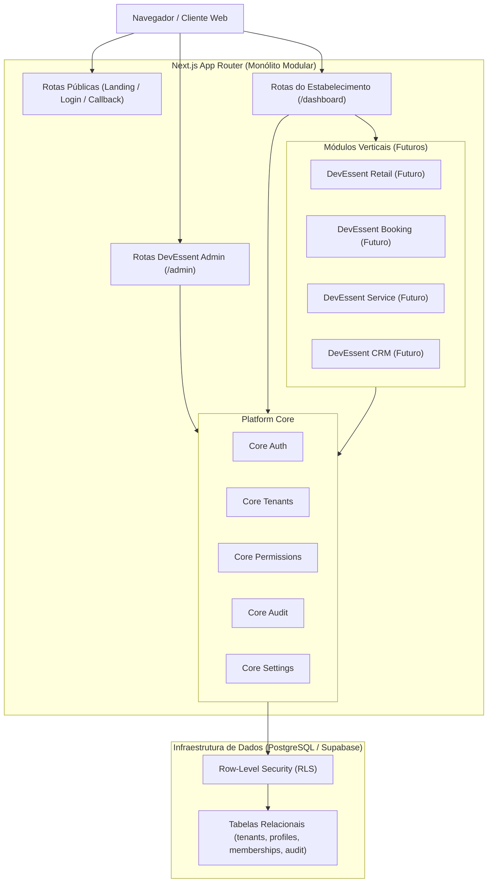

# DevEssent Platform — Arquitetura de Software

## 1. Visão Geral
A **DevEssent Platform Core** é um monólito modular concebido para operar como a espinha dorsal tecnológica das soluções SaaS comercializadas pela DevEssent para micro, pequenas e médias empresas brasileiras.

---

## 2. Direção das Dependências

A aplicação segue a regra unidirecional de dependências:
`Interface (UI/Routes/Actions) → Casos de Uso / Serviços → Repositórios → Infraestrutura / Banco`

- O **Core** disponibiliza contratos e serviços de autenticação, multiempresa, autorização e auditoria.
- Os **Módulos Verticais** consomem os serviços do Core, mas o Core desconhece e jamais importa qualquer módulo comercial.
- A **Interface** nunca realiza mutações privilegiadas ou chamadas de banco sem passar pela camada de serviços e autorização.

---

## 3. Isolamento Multiempresa

O isolamento é garantido em duas camadas independentes:
1. **Camada de Aplicação:** Resolução estrita do contexto do tenant autenticado via sessão e verificação de memberships.
2. **Camada de Banco de Dados:** Políticas de Row-Level Security (RLS) no PostgreSQL ativadas com `FORCE ROW LEVEL SECURITY`.

---

## 4. Stack Tecnológica Fundacional
- **Framework:** Next.js (App Router, Server Actions, Route Handlers)
- **Linguagem:** TypeScript strict
- **Estilização:** Tailwind CSS (tema com paleta sóbria DevEssent)
- **Banco de Dados:** PostgreSQL (Supabase)
- **Validação:** Zod
- **Gerenciador de Pacotes:** pnpm
- **Testes:** Vitest (unitários, integração e segurança), pgTAP (SQL/RLS) e Playwright (E2E)

---

## 4. Consolidação Operacional do Core (Fase 5B)

Para servir como base reutilizável de verticais comerciais sem expor lógica de domínio específica, o Core concentra os seguintes serviços transversais:

- **Auditoria Operacional & Governança:** `AuditService` grava e consulta `public.audit_logs` com sanitização recursiva de metadados (`sanitizeMetadata`), aplicando visibilidade por escopo de papel (`owner` enxerga toda a trilha do estabelecimento; `manager` enxerga apenas ações operacionais permitidas por `MANAGER_VISIBLE_AUDIT_ACTIONS`; `staff` recebe `403 Forbidden`; `platform_admin` acessa a visão global em `/admin/atividades` com filtro por empresa).
- **Normalização Segura de Erros:** `toPublicErrorMessage` e `getFieldErrorsFromError` (`src/core/errors/public-error.ts`) garantem mensagens amigáveis em PT-BR e bloqueiam vazamento de códigos SQLSTATE, PostgREST ou JWT.
- **Proteção Anti-Abuso Durável:** `RateLimitService` (`src/core/security/rate-limit-service.ts`) protege login, recuperação de senha, criação/reabertura de convites e aceitação de convites com identificadores protegidos por hash SHA-256 persistidos em `public.rate_limits`.
- **Contratos para Verticais Comerciais:** A referência de consumo do Core pelos módulos futuros está documentada em [vertical-integration-guide.md](./vertical-integration-guide.md) e [src/modules/README.md](../src/modules/README.md).

