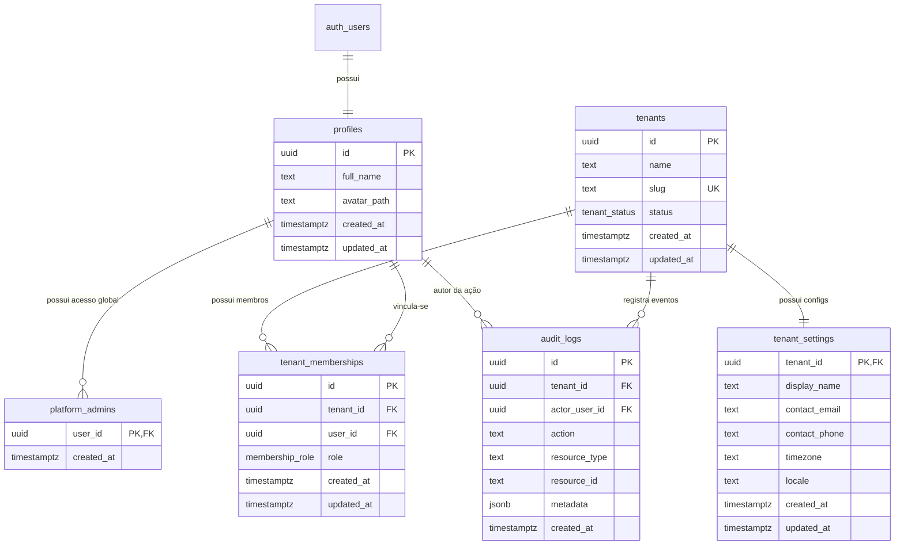

# DevEssent Platform — Modelo de Banco de Dados

## 1. Visão Geral
O banco de dados da DevEssent Platform utiliza PostgreSQL gerenciado via Supabase. Todas as operações com mutação estrutural são versionadas através de migrações SQL no diretório `supabase/migrations/`.

---

## 2. Entidades Fundamentais

### 2.1. `profiles`
Espelha de maneira segura os usuários cadastrados em `auth.users`. Não armazena senhas ou dados criptográficos de autenticação.
- Criado automaticamente após o cadastro em `auth.users` via trigger de segurança.

### 2.2. `tenants`
Representa um estabelecimento / empresa assinante da plataforma.
- `slug`: Identificador único (3 a 50 caracteres minúsculos, letras, números e hífens). Slugs reservados pelo sistema (`admin`, `api`, `login`, etc.) são rejeitados no banco e no domínio.
- `status`: `active` ou `suspended`.

### 2.3. `tenant_memberships`
Mapeia o relacionamento N:N entre usuários e estabelecimentos com papéis explícitos:
- `owner`: Proprietário do estabelecimento.
- `manager`: Gerente/gestor operacional.
- `staff`: Funcionário com acesso restrito.
- Restrição de unicidade composta: `UNIQUE(tenant_id, user_id)`.

### 2.4. `tenant_settings`
Configurações cadastrais e regionais de cada estabelecimento.
- Valores padrão adaptados ao contexto brasileiro (`timezone = 'America/Sao_Paulo'`, `locale = 'pt-BR'`).

### 2.5. `platform_admins`
Tabela com restrição máxima que lista administradores internos da DevEssent. Inserções e remoções são executadas apenas por operações administrativas autenticadas e auditadas via backend autorizado.

### 2.6. `audit_logs`
Trilha de auditoria imutável registrando ações sensíveis (criação de empresa, alteração de configurações, inclusão/remoção de membros, convites, suspensão e reativação).
- A partir da Migration `20260301000007_operational_audit_and_rate_limits.sql`, possui índices compostos por ação (`idx_audit_logs_action_created`), estabelecimento (`idx_audit_logs_tenant_created`) e ator (`idx_audit_logs_actor_created`) para consultas filtradas e paginadas.

### 2.7. `tenant_invitations`
Gerencia convites para ingresso em estabelecimentos com ciclo de vida explícito (`pending`, `accepted`, `revoked`, `expired`).
- O índice parcial único sobre `(tenant_id, lower(email))` para convites `pending` impede duplicidade simultânea, permitindo reenvio após expiração ou revogação.

### 2.8. `rate_limits`
Tabela durável de controle de taxa criada na Migration `007` com `FORCE ROW LEVEL SECURITY` e revogação total de acesso para `PUBLIC`, `anon` e `authenticated`.
- Colunas: `scope`, `identifier` (hash SHA-256), `attempts`, `window_started_at`, `blocked_until`, `updated_at` (`PRIMARY KEY (scope, identifier)`).
- Operada exclusivamente via funções `SECURITY DEFINER` restritas ao `service_role`: `public.consume_rate_limit` e `public.reset_rate_limit`.

